# MindIE-Motor vs llm-d：分布式推理运行时架构与功能对比

- 日期：2026-11-27
- 定位：技术选型与异构 MaaS 架构评估
- 对比基线：MindIE-Motor 3.x 与 llm-d 公开架构（包括此前调研中的 v1.0 能力描述）。
- 证据边界：本文由对话中的架构调研整理而来，未重新逐项核验版本标签、功能合入状态及支持矩阵，未进行实机测试。特性支持必须结合具体 release/commit、引擎、模型、硬件与部署方式验证。以下架构图为职责示意，不是严格的请求路径。

- 更新：补齐 SVG 配图及跨硬件适配工作量；保留 Mermaid、可检索表格及原始 CSV。配图目录：[assets](../assets/mindie-motor-vs-llm-d/README.md)。

## 1. 核心结论

两者均位于 vLLM/SGLang 等引擎之上，承担分布式推理服务的编排和调度。Motor 偏自包含的运行时控制与昇腾深度适配，llm-d 偏 Kubernetes 原生、可组合的服务基础设施。前者更强调实例进程生命周期、PD 拓扑、硬件级可靠性；后者更强调 Gateway API、可插拔选点、缓存感知、多租户与 SLO 治理。

建议纯昇腾生产集群优先评估 Motor，NVIDIA 云原生集群优先评估 llm-d；异构 MaaS 采用统一控制面和多 Runtime Adapter，不强制一种运行时覆盖所有芯片。

## 2. 逻辑架构

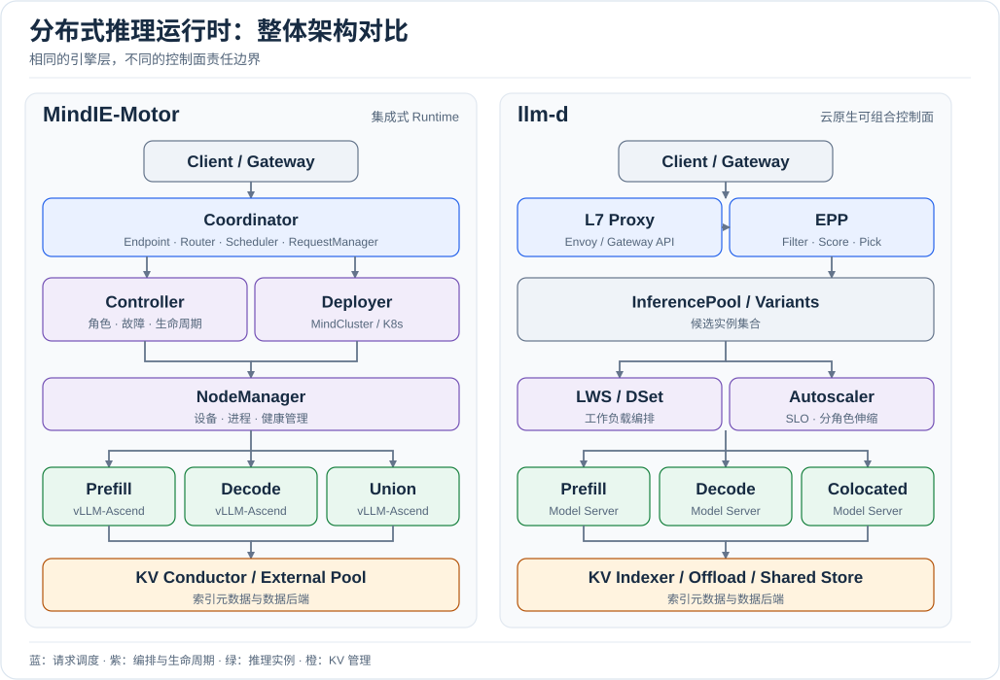

### 2.1 MindIE-Motor

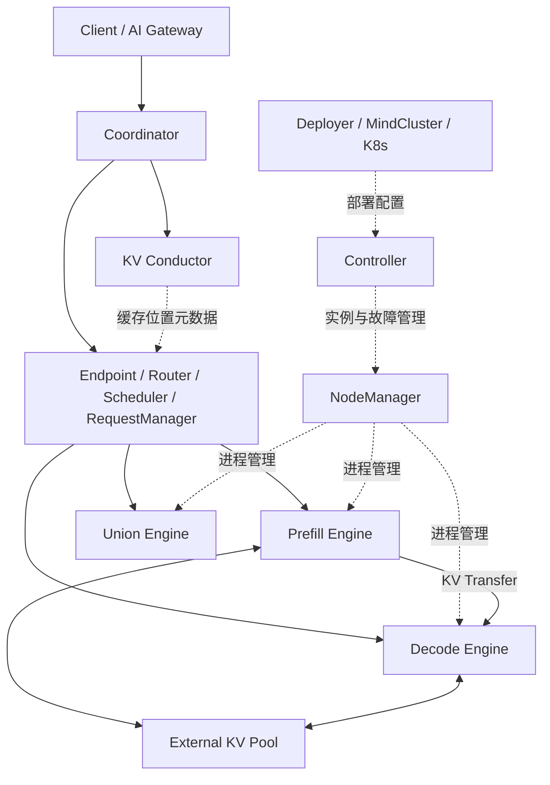

Coordinator 负责请求入口、负载及实例选点、PD 协调；Controller 与 NodeManager 协作管理实例角色、进程及故障；Deployer 承担配置与部署。外部 KV 后端通过引擎 Connector 对接，不应把 Motor 本身视作 KV 数据存储引擎。

### 2.2 llm-d

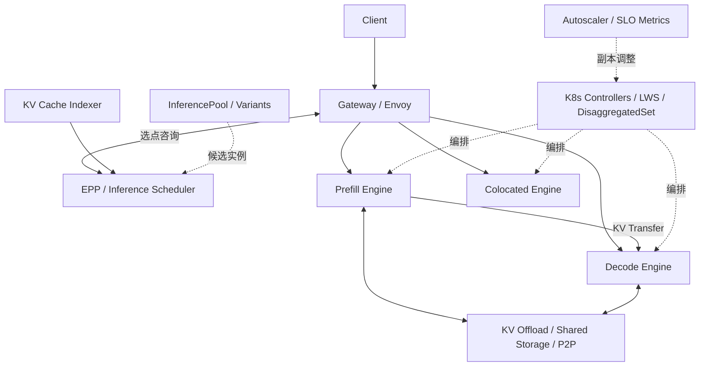

Gateway/代理与 EPP（Endpoint Picker）分工：前者承载流量，后者根据插件生成选点决策。Kubernetes 控制器负责工作负载编排，伸缩与 KV 索引由独立组件提供。具体组件随部署指南和版本变化；图中编排、索引、存储不是请求必须串行经过的路径。

### 2.3 组件映射（非一一等价）

| Motor | llm-d 或相关生态 | 职责 |
|---|---|---|
| Coordinator Endpoint | Gateway / Envoy | 请求入口 |
| Coordinator Router | llm-d Router | 请求转发及 PD 协调 |
| Scheduler | EPP | 实例选点 |
| RequestManager | EPP Flow Control 等 | 请求管理 |
| KV Conductor | KV Cache Indexer | KV 感知调度 |
| Controller | K8s Controllers | 实例生命周期 |
| NodeManager | Kubelet、容器与控制器协作 | 进程与实例管理 |
| Deployer | Helm / Manifests | 配置与部署 |
| InferServiceSet | DisaggregatedSet / LWS | PD 或多节点拓扑编排 |
| MindCluster | K8s / Device Plugin | 资源管理 |

## 3. 功能矩阵

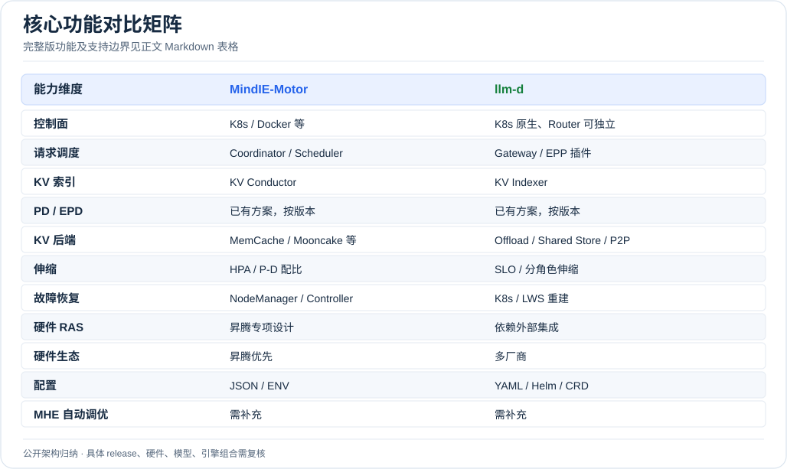

“支持/方案”指此前调研所见的组件或设计能力，不代表所有组合 GA；“待确认”不等于不支持。特别是 llm-d 的新特性和 Motor 的专项 RAS 需核验目标发行版。

| 维度 | MindIE-Motor | llm-d |
|---|---|---|
| K8s 部署 | 支持 | 原生 |
| 非 K8s | Docker、Slurm 等模式需按版本确认 | Router 可独立部署，完整编排以 K8s 为主 |
| 引擎 | vLLM-Ascend、SGLang 适配 | vLLM 为主要路径，SGLang 按集成验证 |
| 硬件 | 昇腾优先 | 多厂商生态 |
| 配置 | JSON / ENV | YAML / Helm / CRD |
| PD 分离及混部 | 支持 | 支持 |
| EPD | 有相关方案 | 有相关方案，版本待核验 |
| Wide EP | 依赖引擎与拓扑 | 专门部署及 Rank-aware 路由方案待版本核验 |
| KV 亲和 | KV Conductor | KV Indexer / EPP |
| 调度插件化 | 有 | Filter / Scorer / Picker 等 |
| 延迟预测 | 同等能力待确认 | 延迟预测插件方向（包括 XGBoost，需核验） |
| Agent 会话亲和 | Agent Hint 等方向 | Session-aware Routing 等方向 |
| 租户优先级 | 限流等基础能力，细粒度待核验 | 优先级及公平性调度方向 |
| KV 全局索引 | KV Conductor | KV Indexer |
| KV 池化与卸载 | MemCache / Mooncake / YuanRong / UCM 等后端 | Offload / Shared Storage，依赖 Connector |
| 跨实例 P2P | 依赖 Connector | 专门方案，需验证版本 |
| 自动伸缩 | HPA / Infer Operator 等 | K8s Autoscaler 与 SLO 方案 |
| P/D 配比调整 | 配比建议及执行方案 | 按角色伸缩 |
| 实例进程恢复 | NodeManager / Controller | 容器及工作负载控制器 |
| ScaleP2D | 专项方案 | 未确认等价机制 |
| HBM UCE 原地快恢 | 与引擎 FT 协同的专项设计 | 未确认等价机制 |
| 精度异常检测 | 专项机制待目标版本验证 | 需额外集成验证 |
| D2D 权重加载 / 快照 | 有相关方案 | 快速加载方案及外部组件，机制不同 |
| 滚动升级 | 按部署模式验证 | 无中断升级方向，需实测 |
| 监控与追踪 | Prometheus / Grafana / Tempo 等 | Prometheus / tracing 生态 |
| OpenAI API | 支持 | 支持 |
| Batch API | 完整能力待确认 | Batch Gateway 方向 |
| 多模型路由 | 需结合 Gateway | Gateway / InferencePool 生态 |
| Stateful Responses API | 待确认 | 相关能力需核验版本 |
| 完整 MaaS 管理前端 | 非核心职责 | 非核心职责 |

## 4. 六个关键差异

### 4.1 请求调度

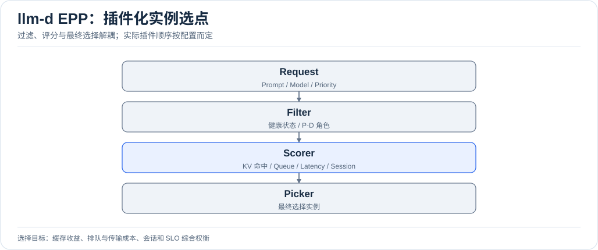

Motor 将请求解析、负载统计、选点、PD 协同与故障隔离集中于 Coordinator。llm-d 将代理与 EPP 决策分离，可组合 Filter（健康与角色）、Scorer（KV 命中、队列、预测时延、会话）、Picker（实例选择）及数据生产插件。

长上下文 Agent 场景可优先 KV 命中；在线聊天可优先预计 TTFT/ITL。注意 KV 命中不一定意味着最低时延，应把剩余 Prefill 计算、排队、KV 传输及 Decode 负载统一计入成本。Motor 也在推进选点插件化；不宜将两者简单归类为固定算法与插件算法。

### 4.2 KV Cache 管理

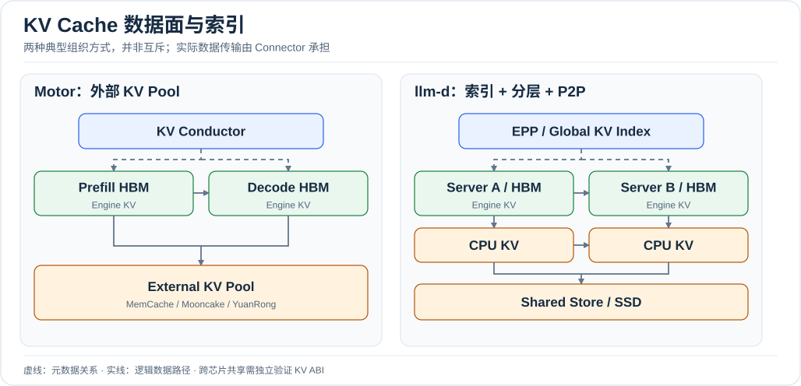

Motor 借助 MultiConnector 等方式组合 PD 实时传输和外部 KV 后端。llm-d 强调全局缓存索引与调度、P2P 获取、分层卸载的协同。两者并不是“一个只有外部池、一个才有全局索引”的互斥设计。

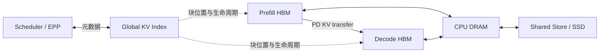

Motor 更适合作为昇腾存储后端集成参考；llm-d 更适合作为全局索引、调度联动与多层缓存组合参考。实际数据移动能力取决于 Connector、引擎和硬件。

跨芯片 KV 共享必须单独验证：模型权重、tokenizer、位置编码、Attention/MLA/SWA/Indexer 状态、dtype、量化 scale、block size、TP/EP 切分、layout、版本及传输协议。定义兼容域，不兼容时转换或回退 Prefill；不能用跨厂商实例路由代替 KV ABI 兼容。

### 4.3 可靠性

Motor 的差异化价值在于设备、引擎进程、分布式实例之间协同恢复。ScaleP2D 在满足角色拓扑和资源约束时，利用 Prefill 资源恢复 Decode 容量；HBM UCE 原地快恢需结合硬件 RAS 和引擎 FT，不能假设所有 UCE 均可原地恢复。llm-d 通常依赖容器重启、LWS Group 重建和副本重调度；尚未确认上述专项机制的等价实现。

对昇腾超节点，应测试故障隔离时间、恢复时间、健康实例影响、请求成功率、KV 污染范围及恢复后的正确性。重启副本不等于恢复在途请求。

### 4.4 弹性伸缩

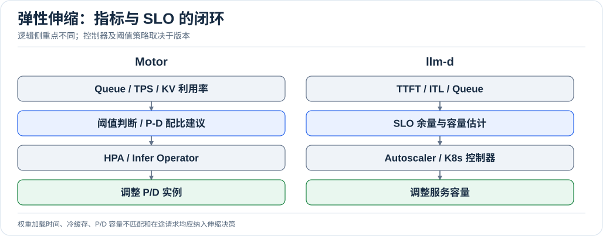

Motor 以负载指标、HPA/Infer Operator 及 PD 配比建议为参考，llm-d 强调 SLO 驱动的伸缩与分角色容量调整。此前调研指出 llm-d WVA 有弃用迹象，正式选型前需核实目标版本的替代控制器与 API，避免绑定过时组件。

伸缩须考虑权重加载时间、缓存冷启动、P/D 容量不匹配和集群资源约束。要将排队、TTFT、TPOT/ITL、吞吐、KV 使用率与有效命中率联合纳入决策，不能只凭 KV 使用率判断瓶颈。

### 4.5 硬件生态

| 硬件 | Motor | llm-d |
|---|---|---|
| NVIDIA | 非主要路线 | 主要路线 |
| Ascend 910B | 重点生态，组合需验证 | 有基础接入方向，完整能力待验证 |
| Ascend 910C / 950PR / DT | 优先评估，按具体产品和版本核验 | PD、Wide EP、KV 和 RAS 待端到端验证 |
| AMD / TPU / Intel XPU | 未确认 | 多硬件生态，具体指南和版本待确认 |
| 天数、沐曦、壁仞、摩尔线程 | 未确认 | 不应仅凭社区集成宣称完整支持，需核验 |

此前调研涉及 Ascend 上 Envoy + EPP + vLLM-Ascend 的单卡、非 K8s 基础接入示例。即便可运行请求链路，也不等价于完整的 PD 分离、Wide EP、KV 池化与 RAS 适配。

### 4.6 MHE 配置管理

| 维度 | Motor | llm-d |
|---|---|---|
| 模型与并行参数 | engine_config | Container Args |
| 硬件 | user_config.json | Resource / NodeSelector |
| 环境变量 | env.json | Container Env |
| PD 拓扑 | motor_deploy_config | DisaggregatedSet 等 |
| 模板 | model_configs | Guides / Helm Values |
| 参数生成 | 脚本转换等工具 | 部署模板 |
| 兼容性知识库 | 不完整 | 不完整 |
| 自动调优闭环 | 不完整 | 不完整 |

自建平台的价值是将 Model × Hardware × Engine × Version × SLO 作为可查询、可验证的配置域，自动生成量化、TP/DP/EP、PD 配比与启动参数，并管理配置版本、实验记录、回归与回滚。

## 5. 工程能力主观评分

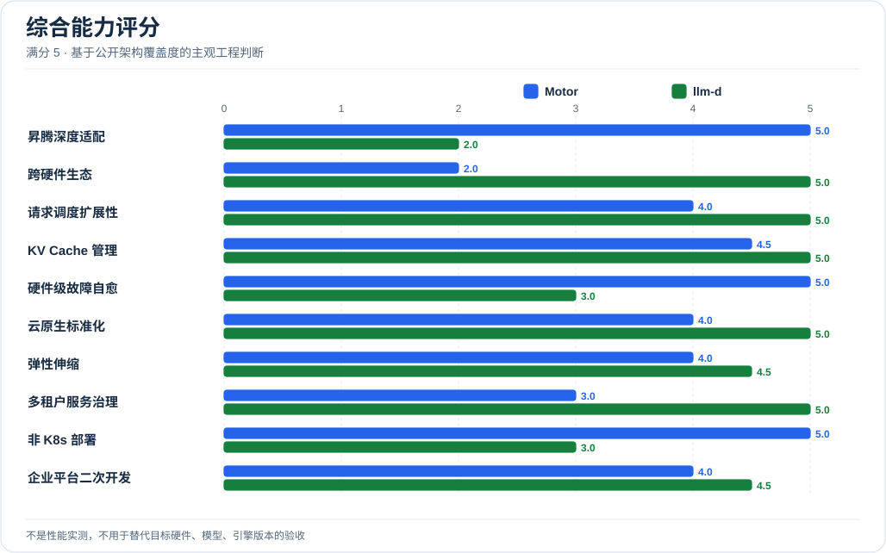

满分 5，仅为架构覆盖度判断，不是 benchmark；硬件/引擎版本不同会改变评分。

| 能力 | Motor | llm-d |
|---|---:|---:|
| 昇腾深度适配 | 5 | 2 |
| 跨硬件生态 | 2 | 5 |
| 请求调度扩展性 | 4 | 5 |
| KV 管理 | 4.5 | 5 |
| 硬件级故障自愈 | 5 | 3 |
| 云原生标准化 | 4 | 5 |
| 弹性伸缩 | 4 | 4.5 |
| 多租户治理 | 3 | 5 |
| 非 K8s 部署 | 5 | 3 |
| 企业平台二次开发 | 4 | 4.5 |

## 6. 统一异构推理平台建议

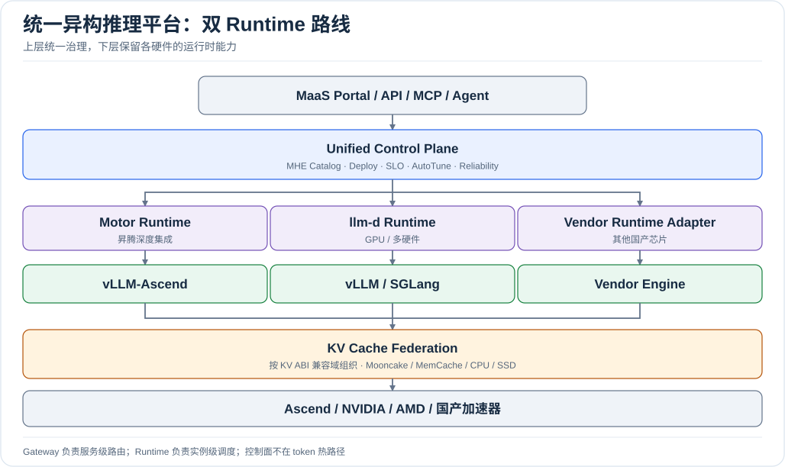

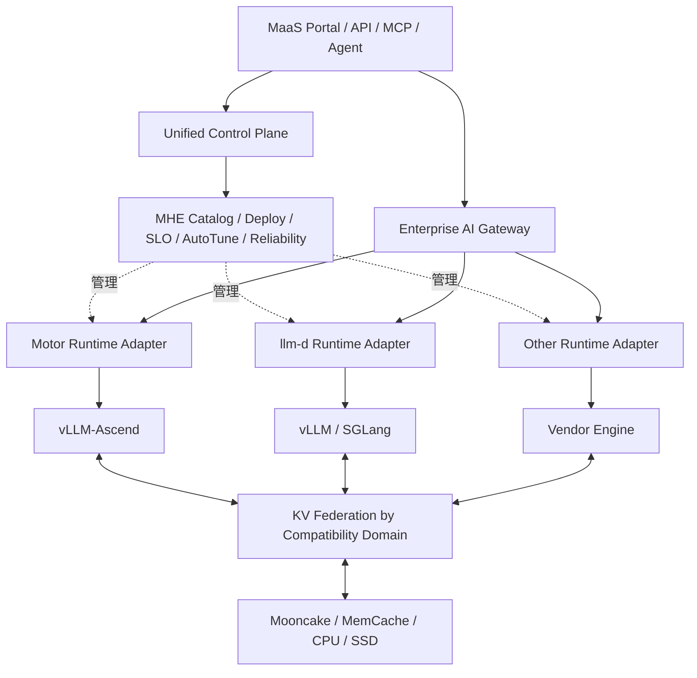

| 模块 | 建议 |
|---|---|
| 昇腾 Runtime | 复用 Motor |
| NVIDIA Runtime | 复用 llm-d |
| 其他国产 Runtime | Adapter 接入 |
| 统一编排 | 声明式 ModelDeployment 与 Runtime Adapter |
| 模型及硬件路由 | 自研/集成服务级路由，参考 EPP；实例级路由交给 Runtime |
| MHE Catalog | 自研，版本化和可验证 |
| KV Federation | 复用后端，自研兼容域、元数据及适配 |
| 自动部署和性能调优 Agent | 自研，结合实验与正确性门禁 |
| 硬件 RAS | 复用厂商机制，上层统一事件与恢复状态 |
| AI Gateway | 集成成熟开源网关，避免双重实例选点 |
| 可观测性 | Prometheus / Grafana / OpenTelemetry |

注意控制面与数据面分离：统一控制面不位于每次 token 的热路径；Gateway 不应重复执行 Motor 或 EPP 的实例级 KV 选点；KV Federation 不意味着所有硬件可以直接共享二进制缓存。

## 7. 选型建议

| 目标 | 推荐路线 |
|---|---|
| 纯昇腾 / 910C / 950 超节点 | Motor 优先 |
| NVIDIA 大规模 PD | llm-d 优先 |
| 多厂商 MaaS | 统一控制面 + 双 Runtime |
| 跨硬件 KV | 独立 KV Federation 层 |
| Agent 服务 | 重点参考 llm-d 路由与会话能力 |
| 私有化一体机 | 根据硬件选择 Runtime，统一安装和运维 |
| 自研 AI Infra | MHE、异构管理、KV 兼容域、自动性能调优 |

## 8. 跨硬件适配：Motor → GPU vs llm-d → NPU

**结论：在已有推理引擎与 Connector 的前提下，常规生产功能对齐通常是 llm-d 适配昇腾 NPU 更省工；仅做 PD 分离时两条路线可能接近甚至反转。如果要求完整 Motor 级硬件 RAS 对齐，则不能直接比较常规适配成本。**

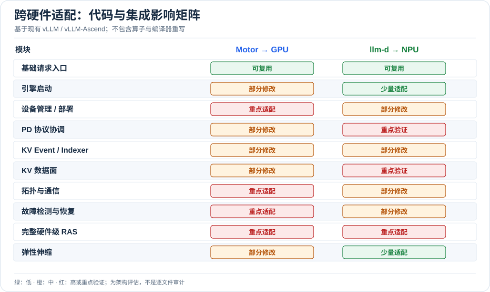

### 8.1 第一性原理与范围

总成本 W = W(部署) + W(接口) + W(数据面) + W(RAS) + W(验证)。决定成本的是硬件相关逻辑侵入的层数与耦合度、目标硬件数据面成熟度，以及运行时自身承担的可靠性责任，而非代码行数。假定 GPU 为 NVIDIA，NPU 为昇腾 910B/910C/950 系列，使用既有 vLLM/vLLM-Ascend，不包含算子、编译器、驱动及底层传输引擎从零开发。

| 模块 | Motor → GPU | llm-d → NPU |
|---|---|---|
| 请求入口 / 选点 | 大体复用 | 大体复用 |
| 引擎启动 | 中等 | 较小 |
| 设备管理 / K8s | 较大，需剥离 MindCluster 耦合 | 较小至中等，设备插件和 Overlay |
| PD 分离 | 中等，复用 NIXL 协调路径需验证 | 中等至较大，Mooncake 协议需验证 |
| KV 池化 | 中等，GPU 后端较成熟 | 中等，昇腾后端集成 |
| 通信配置 / 拓扑 | NCCL / NVLink / PCIe 适配 | HCCL / HCCS / UB 适配 |
| 监控 | NVML / DCGM 与原指标契约 | NPU Exporter 与 EPP 指标 |
| 故障检测 | 较大 | 中等 |
| 故障自愈 / 权重快载 | 目标依赖，完整对齐较大 | 目标依赖，完整对齐较大 |
| 伸缩 | 中等 | 较小，按角色和资源适配 |

### 8.2 引擎启动与设备管理

Motor 已有原生引擎启动方向（vllm serve、sglang.launch_server），需要隔离设备资源分配、环境变量、拓扑、监控及恢复逻辑。建议 DeviceBackend 抽象，不在核心代码大量添加 if GPU。

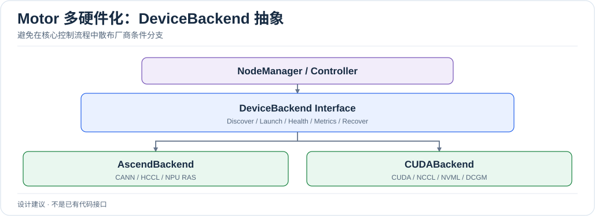

| 昇腾 | NVIDIA 对应生态（非严格一一等价） |
|---|---|
| ASCEND_RT_VISIBLE_DEVICES | CUDA_VISIBLE_DEVICES |
| CANN / HCCL | CUDA / NCCL |
| torch_npu / NPU Graph | torch.cuda / CUDA Graph |
| NPU 拓扑 / RAS | NVLink、PCIe、NVML、DCGM |
| Ascend Operator / Device Plugin | GPU Operator / Device Plugin |
| RankTable | NCCL 多机启动与 Rank 配置 |

llm-d 的控制面通过 Kubernetes Pod 启动引擎，通常替换 vLLM-Ascend 镜像、NPU Resource/Device Plugin、挂载、HCCL 与模型参数；InferencePool、EPP、LWS 等通用机制可以复用。仍须验证拓扑亲和、Gang Scheduling、多机 Rank、网络资源、健康检查及权限，不应将配置替换等同于完整支持。

### 8.3 PD 分离是例外

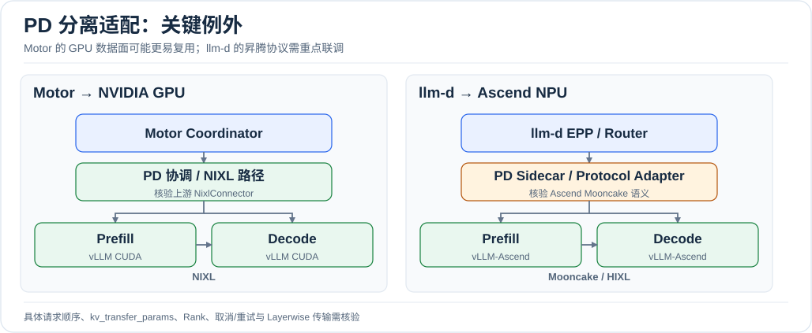

此前调研发现 Motor 3.2 的设计包含 NixlConnector 及 Prefill Handoff Decode、Mooncake 与 Layerwise 等协调模式；llm-d Router 也有多 Connector 路径。若 GPU 侧 vLLM NIXL 与 Motor 协议匹配，可减少核心修改；llm-d 使用 Ascend Mooncake 时应验证其 V1/V2、Layerwise、Push/Pull 的交互差异。

关键合同：kv_transfer_params、P/D 请求顺序、Block 分配和释放、Transfer ID 与 DP Rank 映射、取消、超时、失败重试、Layerwise 增量传输。协议兼容时复用传输引擎，不自行重写 KV 数据面。

### 8.4 KV 数据面与集群可靠性

Motor 可复用 CUDA vLLM KV Event、Token Block Hash、NIXL、Mooncake、GPU CPU/SSD Offload；llm-d 可复用兼容的 vLLM-Ascend 事件与现有 Mooncake、MemCache、YuanRong、LMCache-Ascend 等后端。应分别核验事件语义、索引准确性、传输后端及缓存生命周期。910C Linux 5.10 + 灵衢的底层地址空间约束不会被上层控制面消除。

常规恢复包括 Pod/进程重启、故障隔离、分布式副本重建；完整 RAS 还涉及 UCE 原地快恢、通信恢复、ScaleP2D、请求续推、权重 D2D 加载。Motor → GPU 需要适配 GPU RAS 与引擎能力；llm-d → NPU 若要对齐 Motor 全部功能，需额外实现或集成运行时管理，可能反而更贵。重启、恢复在途请求和无损恢复必须分开验收。

### 8.5 人周估算

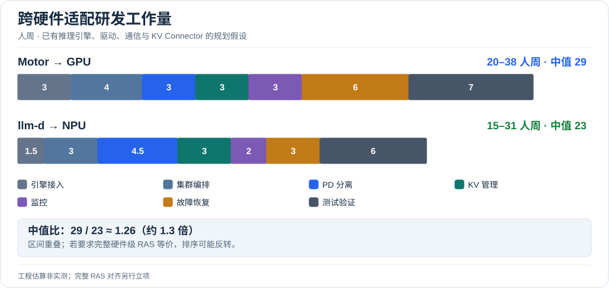

| 模块 | Motor → GPU（人周） | llm-d → NPU（人周） |
|---|---:|---:|
| 引擎接入 | 2–4 | 1–2 |
| 集群编排 | 3–5 | 2–4 |
| PD 分离 | 2–4 | 3–6 |
| KV 管理 | 2–4 | 2–4 |
| 监控 | 2–4 | 1–3 |
| 故障恢复 | 4–8 | 2–4 |
| 测试验证 | 5–9 | 4–8 |
| **合计** | **20–38** | **15–31** |
| **区间中值** | **29** | **23** |

中值比 29/23 ≈ 1.26，约 1.3 倍；区间重叠，不能声称确定倍数。原始数据：[CSV](../assets/mindie-motor-vs-llm-d/effort-data.csv)。完整 RAS 对齐、底层驱动/算子开发、无法复用的 Connector 另行估算。

假设 4 位具备分布式推理经验的工程师，以下为考虑联调、依赖及测试后的累计日历周期（不是各阶段相加）：

| 交付阶段 | Motor → GPU | llm-d → NPU |
|---|---|---|
| 基础混部 PoC | 1–2 周 | 2–5 个工作日 |
| 多机 PD 分离 | 2–4 周 | 2–4 周 |
| KV 池化、集群管理 | 4–6 周 | 3–5 周 |
| 常规生产可用 | 7–12 周 | 5–10 周 |
| 完整 RAS 等价 | 单独立项 | 单独立项 |

### 8.6 长期多厂商路线

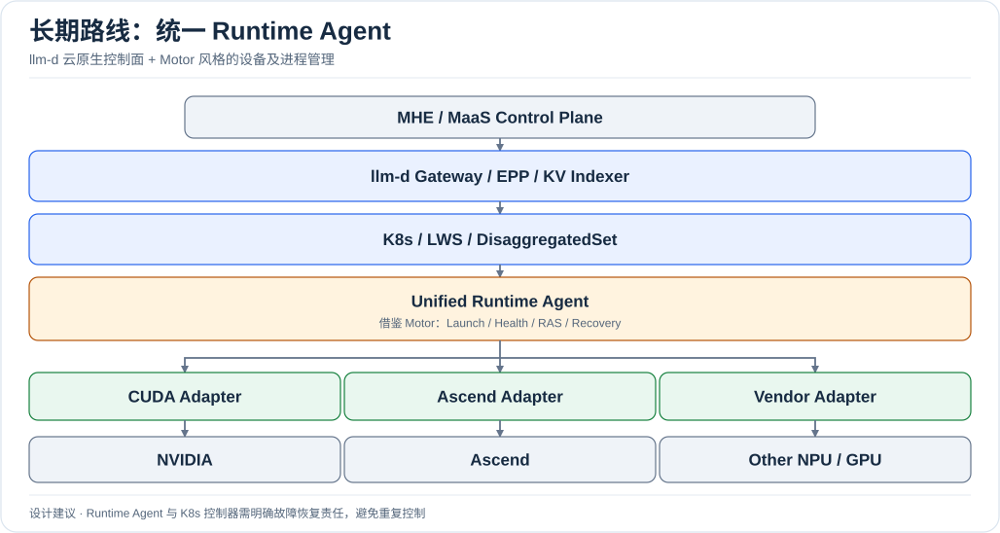

面向 NVIDIA、昇腾及其他国产加速器，建议参考 llm-d 的通用路由、K8s 编排与 Overlay，同时抽象独立 Runtime Agent 以统一设备管理、健康与恢复契约。不要在 Agent 和 K8s Controller 同时执行相同故障恢复动作。若必须支持非 K8s 环境或保留 Motor 全量特性，可优先评估 Motor 多硬件化。

优先 PoC：① 910C llm-d + vLLM-Ascend + Mooncake 多机 PD；② KV Indexer 消费真实 KV Event 并验证亲和；③ 接入 NPU 故障检测并验证分布式实例隔离、恢复。三个路径均通过后再评估生产化排期。此前对话提及的 NIXL、Ascend Mooncake、版本支持与具体 RAS 特性本次未重新逐文件审计。

## 9. 建议 PoC 与验收（新增工程验证项）

| 测试 | 条件 / 观测 |
|---|---|
| 基线 | 固定模型权重、dtype、并行、引擎 commit、硬件与数据集；分别记录 TTFT、TPOT/ITL、吞吐及 Goodput |
| PD | 1P1D、3P1D；长短请求混合，测试队列、KV transfer、P/D 瓶颈及 SLO |
| KV | 冷/热缓存、跨实例命中、CPU/SSD 卸载、缓存淘汰；检查真实命中与传输字节数 |
| 扩缩容 | 阶跃负载；检查 P/D 配比、权重加载、缓存冷启动和在途请求 |
| 故障 | 模拟进程退出及节点故障；设备错误仅用厂商支持的测试方式；记录 RTO、请求成功率、正确性 |
| 异构 | 先分别验证服务级路由，再验证兼容域内 KV 共享；不兼容时回退 Prefill |
| 配置 | MHE 模板生成、回滚、版本兼容检查；同配置重复部署 |
| 可观测性 | 关联 Gateway、Runtime、Engine 请求 ID 与指标，检查实际延迟归因 |
| 正确性 | 同模型同精度同后端做 logits/KV 一致性；不同硬件或量化策略先定义合理误差阈值，不默认可逐位一致 |

## 10. 参考入口及待核验事项

- [MindIE-Motor 项目](https://github.com/Ascend/MindIE-Motor)
- [MindIE-Motor 文档](https://mindie-motor.readthedocs.io/)
- [llm-d 项目](https://github.com/llm-d/llm-d)
- [llm-d 文档](https://llm-d.ai/docs/)
- [llm-d Router（此前调研入口）](https://github.com/llm-d/llm-d-router)
- [llm-d 架构（此前调研入口）](https://llm-d.ai/docs/architecture)
- [ModelSphere vs MindIE Motor](modelsphere-vs-mindie-motor-control-plane-2026-11-06.md)
- [AI Gateway 选型](ai-gateway-comparison-for-mindie-motor-and-heterogeneous-maas-2026-11-06.md)
- [Ascend 910C / Linux 5.10 / 灵衢 KV Pool 约束](ascend-kernel510-hccs-dram-address-mismatch-kv-offload-comparison.md)

此前对话中的版本发布日期、细分硬件矩阵、WVA 弃用、Batch/Responses API、ScaleP2D/UCE、EPD 与多租户 SLO 等细项未在本次归档时重新核验；应在生产决策前以目标 release、源码与官方支持矩阵为准。本文不声称目标组合已通过实机验收。
