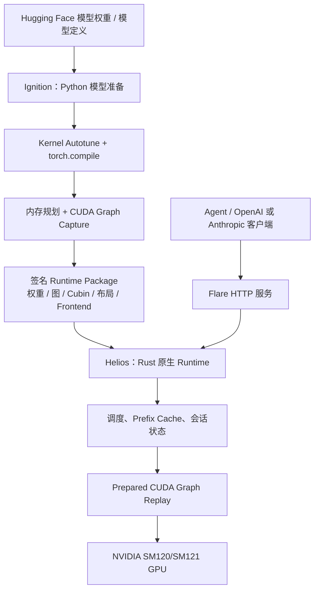

# NVIDIA Flare Local Inference：架构、vLLM 对比及 RTX PRO 5000 适配评估

> 调研日期：2026-10-24  
> 项目：<https://github.com/NVIDIA/flare-local-inference>  
> 许可证：Apache-2.0（引擎代码；模型权重及依赖须分别核对许可）  
> 定位：针对 NVIDIA SM120/SM121、长会话和本地 Coding Agent 的 **research prototype**。  
> 证据口径：上游 README、`AGENTS.md`、`docs/core-design.md`、`docs/model-preparation.md`、`docs/api.md`；不把设计目标视为已完成的生产验证。

## 一、结论摘要

**Flare 的核心价值不是“用 Rust 重写 vLLM”，而是把 Python 模型构建与原生 Runtime 服务执行分离**：

1. **Ignition（Python）** 复用 PyTorch、Transformers、FlashInfer/b12x，加载权重、选择和调优 Kernel、编译 forward、规划显存并预先 Capture CUDA Graph。
2. **Runtime Package** 将权重、Kernel、Graph、显存布局、Frontend 信息及执行边界一起封装；已发布格式采用带签名的 Protobuf 信封和独立的不可变 Payload Blob。
3. **Helios（Rust）** 在没有 Python 回调的服务进程中管理 HTTP API、请求调度、缓存页、完整会话状态与 CUDA Graph Replay。不会在正常服务路径中重新编译、重新 Capture，也不应有稳定运行期 GPU 分配。
4. **强约束专用化**：限定 NVIDIA SM120/SM121 和已经准备的模型 Recipe、TP 拓扑、并发/Shape 容量，换取明确的资源契约和较小的兼容性矩阵。
5. **Agent 状态完整性**：Prefix Reuse、分支恢复、推测解码回滚处理的不只是 Attention KV，还包括 GDN/KDA/Mamba 等状态及相关历史信息。

对现有 **8× RTX PRO 5000 72GB/节点 × 2** 的环境，Flare 适合作为**专用推理引擎架构参考和小规模性能对照 PoC**，不宜在缺少模型/TP/内核实测的情况下直接替换 vLLM 生产环境。

## 二、系统架构和代码归属



| 部件 | 上游目录 | 核心职责 |
|---|---|---|
| Ignition | [`ignition/`](https://github.com/NVIDIA/flare-local-inference/tree/main/ignition) | Model Recipe、权重映射、编译、调优、图 Capture、导出 |
| Helios | [`helios/`](https://github.com/NVIDIA/flare-local-inference/tree/main/helios) | Rust Runtime、请求调度、缓存与原生 CUDA 执行 |
| Heliopause | [`heliopause/`](https://github.com/NVIDIA/flare-local-inference/tree/main/heliopause) | Python 准备流程调用 Rust/原生执行能力的扩展 |
| Flare CLI | [`flare/`](https://github.com/NVIDIA/flare-local-inference/tree/main/flare) | `flare run` 等命令行服务入口 |
| Kernel | [FlashInfer](https://github.com/flashinfer-ai/flashinfer) / b12x | CUDA 算子、通信与调优；准备依赖具体 fork/固定 revision |

### 为什么这种分层有价值？

- **开发时保留 PyTorch 生态**：避免为每个模型在 Rust 里重新实现 Transformer 计算和加载。
- **运行时封闭执行集**：CUDA Graph 是模型执行边界；超出导出时捕获的容量应明确拒绝，而不是退化为 Eager/动态编译。
- **跨模型复用的是资源和状态管理契约**：具体算子图仍由 Recipe 定义，Helios 不靠模型名字切换调度策略。
- **代价**：模型、TP 配置或导出时的资源上限变更，通常需要重新准备相应运行包；诊断与更新流程不同于通用在线加载引擎。

注意：一次导出产生的主 `.safetensors` 是元数据文件，配合 SHA-256 命名的不可变 Payload Blob 使用，不能只复制主文件就认为拿到了完整模型包。包还包含签名和运行前信任配置，详见官方准备文档。

## 三、与 Agent/长上下文直接相关的优化

### 3.1 完整推理状态，不限于 KV Cache

Flare 将 KV Page、Recurrent State、卷积历史、Selector/Indexer 状态、隐藏态与 Speculative Rollback 等视为会话连续状态。对混合注意力/状态空间模型，单独恢复 KV 不能确保语义正确；恢复点必须对应同一个已提交 Token 前缀。

这直接适用于：
- Coding Agent 工具调用后持续追加 Context；
- 共享系统提示或代码库前缀的多个分支；
- 对话分支 Fork、Resume、Prefix Reuse；
- MTP/DSpark 等推测解码的接受、回滚、复算正确性。

### 3.2 静态图 + 有界动态调度

Prefill、Decode 和模型支持的推测解码均提前准备图/容量。Rust Runtime 可调度不同请求，但不能突破已导出包声明的上下文、并发、Graph Shape 和状态资源边界。显存调优、可预测性与扩展灵活性之间存在明确取舍。

### 3.3 模型特定的 Host/Disk Embedding 访问

以 Qwen3.8 Flash 为例，官方准备文档描述 PLE 表约 **26.8 GiB**，默认可由 Helios 从磁盘读取所需行，也可通过 `flare run --embedding-table-storage ram` 放入 Host RAM；GPU 在 Graph 里使用间接行缓冲。此机制不是把所有推理权重、KV Cache 都自动卸载。

### 3.4 Prefix Cache 多层存储：区分设计与实际验证

官方架构文档讨论了完整 Checkpoint 的 Host/Disk Offload 及分层前缀缓存契约，参见 [prefix-cache-offload.md](https://github.com/NVIDIA/flare-local-inference/blob/main/docs/prefix-cache-offload.md)。

**不得据此直接推断** Flare 已经提供可替代 Mooncake/LMCache 的成熟、可规模化远程 KV Pool。特别是跨节点 P/D KV 传输、存储后端可替换性、异构平台连接器，尚不能等同于 vLLM + Mooncake/LMCache 的能力。

## 四、硬件与模型适配边界

### 4.1 GPU/并行

| 硬件或场景 | 判断 | 备注 |
|---|---|---|
| RTX PRO 5000 Blackwell 72GB | **架构匹配，具体配置需实测** | Blackwell SM120 类设备；不是官方逐配置验收保证 |
| RTX PRO 6000 Blackwell | **架构匹配** | 同属目标 SM120 |
| DGX Spark / GB10 | **目标平台** | SM121，官方明确面向紧凑系统 |
| H800 / H100 / H20 | **非目标硬件** | Hopper SM90，Flare 不提供通用后端兼容 |
| Ascend 910B/910C | **不支持** | 无昇腾后端，且项目明确不设计硬件抽象层 |
| 同一主机多卡 TP | **有支持，受 Recipe 限制** | TP 必须按导出包重新准备 |
| 跨主机 TP | **在设计范围内** | 具体传输、模型、平台仍须验收 |
| 8 卡 TP8 | **不能由 GPU 架构匹配推出已支持** | 请先检查目标 Recipe 和上游验证记录 |
| PD 分离 / 动态 EP | **非当前核心能力** | 不作为 Flare 直接替代 vLLM 分布式方案的依据 |

官方准备文档明确：**Qwen TP1/TP2、GLM TP4 做过端到端执行；Qwen TP4 仍需模型验证**（该状态会随上游变化）。因此对 8× RTX PRO 5000，不宜直接假设 TP8 可用。

### 4.2 模型 Recipe（非穷尽）

| Recipe/模型示例 | 代码或文档证据 | 主要关注点 |
|---|---|---|
| Qwen3.8 Flash | [准备文档](https://github.com/NVIDIA/flare-local-inference/blob/main/docs/model-preparation.md#qwen38-flash) | GDN/PLE、MTP、长 Agent Context |
| Qwen3.8 27B | [同上](https://github.com/NVIDIA/flare-local-inference/blob/main/docs/model-preparation.md#qwen38-27b) | 单卡 NVFP4 密集模型基线 |
| GLM 5.3 Flash | [Recipe](https://github.com/NVIDIA/flare-local-inference/tree/main/ignition/recipes/glm53) | KDA、Indexed MLA、TP1/TP2/TP4 |
| DeepSeek V4.1 Flash | [Recipe](https://github.com/NVIDIA/flare-local-inference/tree/main/ignition/recipes/deepseek41) | TP4、DSpark、MXFP4 Scale 压缩 |
| DeepSeek V4 Flash | [Recipe](https://github.com/NVIDIA/flare-local-inference/tree/main/ignition/recipes/deepseek4) | 模型专用注意力和状态管理 |
| Nemotron 3.5 Bolt | [准备文档](https://github.com/NVIDIA/flare-local-inference/blob/main/docs/model-preparation.md#nemotron-35-bolt-74b-a9b-24gb) | Mamba-2、LiLiCorr、单卡场景 |
| Kimi K3、MiniMax-M3.1-Flash、Step-5 Preview | [Recipes](https://github.com/NVIDIA/flare-local-inference/tree/main/ignition/recipes) | 存在 Recipe 不等于目标拓扑/精度已验证 |

**兼容性含义**：存在 Recipe 仅证明有实现入口和声明，不能推论任意 checkpoint、上下文长度、TP8、量化组合与 API 路径都通过了集成测试。

### 4.3 默认 KV 精度

官方准备文档称 Recipe 默认使用 **FP8 E4M3 KV**，但部分模型继续保留自身的 BF16 Selector Key、打包 Latent、Scale/Rotary 字段、Recurrent State 等。不能用单一的“全部 KV=FP8”公式估计内存；应按模型实际状态布局计算峰值内存。

## 五、Flare 与 vLLM 的工程对比

| 维度 | Flare | vLLM |
|---|---|---|
| 目标 | 单机/紧凑部署、专用模型、长 Agent 对话 | 多模型、多设备、通用高吞吐 Serving |
| 预处理路径 | Python 预准备、编译、调优、Graph Capture | 模型在线初始化与多种编译/图执行策略 |
| 在线 Runtime | Rust Helios，无 Python 模型回调 | Python 调度/服务与原生 GPU 执行组件协同 |
| Kernel 耦合 | 专门绑定 FlashInfer/b12x | 多 Backend，部署组合更广 |
| 执行图 | 强调预捕获图，超容量拒绝 | 支持 CUDA Graph，也提供其他执行策略 |
| 动态容量 | 有限于 Package 声明 | 相对通用灵活 |
| KV/会话状态 | 全会话状态 Checkpoint 是架构中心 | 通用 KV 管理，模型状态能力随后端/版本变化 |
| TP/集群 | 支持选定单机/跨机 TP | 更广泛的分布式推理生态 |
| PD 分离与远程 KV | 非主要卖点，需单独验证 | vLLM Connector、Mooncake/LMCache 等方案 |
| 生产成熟度 | Research Prototype | 大规模生产实践生态更成熟 |

**不应直接宣称 Flare 性能超过 vLLM**：必须以同一模型、精度、Token 预算、Speculation 策略、TP 拓扑和硬件进行对比；未经统一条件校准的 TPS、TTFT 数字没有可比性。Rust 并不自动意味着 GEMM/Attention 更快，收益可能来自图覆盖、KV 状态、Kernel、量化和通信协同。

## 六、RTX PRO 5000 72GB 的最小 PoC

### 6.1 构建与导出

以下为上游命令的缩小并发改写例子：先在可用的两张 SM120 卡上验证 **Qwen3.8 Flash TP2**。运行前确认 CUDA Toolkit、Driver、Hugging Face 权限、GPU 空闲空间及导出包签名信任设置。导出可能较慢并消耗额外磁盘空间。

```bash
git clone https://github.com/NVIDIA/flare-local-inference.git
cd flare-local-inference

sudo apt-get install -y build-essential cmake ninja-build pkg-config \
  protobuf-compiler libssl-dev python3-dev liburing-dev

uv sync --locked --extra prepare --extra test
cargo build --release --manifest-path flare/Cargo.toml

nvidia-smi

.venv/bin/ignition export qwen3.8-flash \
  --gpus 0,1 \
  --max-concurrency 4 \
  --output /data/flare-runtime/qwen38-tp2-c4.safetensors \
  --verbose

./flare/target/release/flare run \
  /data/flare-runtime/qwen38-tp2-c4.safetensors \
  --gpus 0,1 --bind 127.0.0.1:8001
```

上面的 `--bind` 和 `--gpus` 语义以官方 [model-preparation.md](https://github.com/NVIDIA/flare-local-inference/blob/main/docs/model-preparation.md) 为准；若目标主机是离线环境，另需设计源码、Hub 模型、依赖包、编译产物及开发签名公钥的离线分发。

API 可通过 `/v1/models` 探测，主要协议包含：
- `POST /v1/chat/completions`
- `POST /v1/completions`
- `POST /v1/responses`
- `POST /v1/messages`（Anthropic 风格）

接口能力、采样参数、工具调用、图像和日志概率约束见 [docs/api.md](https://github.com/NVIDIA/flare-local-inference/blob/main/docs/api.md)。

### 6.2 推荐验证矩阵

| 阶段 | 变量 | 验收重点 |
|---|---|---|
| 1. 正确性 | Qwen3.8 Flash、TP2、短 Context | 导出/加载/API 流式成功、文本/工具调用一致性 |
| 2. 资源基线 | 并发 1/4/8/16，1K/16K 输入 | 显存峰值、Host RAM、图与权重占用、GPU 利用率 |
| 3. 长上下文 | 32K/64K 输入，输出 256/1024 | TTFT p50/p95、TPOT/ITL、OOM/超容量拒绝表现 |
| 4. Agent 续接 | 共享 Prefix、Fork、工具响应续接 | 完整状态恢复、前缀命中收益与结果一致性 |
| 5. Speculation | MTP/DSpark 开/关（有对应 Recipe 才测） | 接受率、吞吐增益、显存代价、正确性 |
| 6. TP 扩展 | 在官方允许的 TP1/TP2/TP4 中逐步扩展 | PCIe 通信开销、模型是否真正端到端通过 |
| 7. vLLM 对照 | 同卡、同权重/精度、同请求序列 | 输出 tokens/s、TTFT、TPOT、p95 延迟、失败率 |

针对 **2 台 × 8 卡 RTX PRO 5000 72GB（无 NVLink、以 PCIe 为主）**：

- **首选**同机 TP2 取得稳定结果，再按官方 Recipe 支持情况尝试 TP4；不要首先以 TP8 或跨机 TP16 开题。
- 单机跨 PCIe Switch TP 的通信、CUDA Graph 资源和 Kernel 预编译兼容性，是重点瓶颈；不能用单卡性能线性推导。
- 当前主要研究目标是 *Dedicated Engine vs vLLM*，而不是同一轮 PoC 再叠加 PD 分离、远程 KV 池和多机 Agent 调度。

### 6.3 停止条件

遇到以下任意问题先暂停性能跑分，转入兼容性排障：

1. 导出成功但 Rust Runtime 在 CUDA Graph 初始化/重放时报错；
2. Graph 声明容量与服务请求不匹配；
3. 模型输出正确性、MTP 回滚或 Prefix 恢复测试不通过；
4. TP 组合无上游验证依据且出现无法定位的 Kernel/通信异常。

## 七、设计启发及与既有工作的关系

1. **专用模型 + 硬件引擎**：可借鉴 Flare 的 Python Recipe → Frozen Package → 原生 Runtime 分层，不必从零重写 PyTorch 模型生态。
2. **Agent 完整 State ABI**：可与 [Client-Owned KV Cache 方案](client-owned-kv-cache-design.md) 对照。Flare 当前是服务端管理完整会话状态；Client-Owned 方案强调将状态所有权、快照生命周期和移动控制权交给客户端。这是互补但不同的控制权边界。
3. **引擎自进化与回滚**：将验证过的模型+Kernel+图制作为不可变、版本化 Runtime Package，能提供更清晰的发布/回退对象；但故障自动回滚仍需独立的流量切换、健康检查和状态恢复机制，Flare 本身并不自动解决。
4. **PD 分离/KV Offload**：不宜以 Flare 替换 vLLM-Ascend、Mooncake、LMCache 等多节点数据面；相关能力和接口需另行开发与验证。
5. **商用交付**：技术原型与产品成熟度分开评价；需要压测、稳定性、Observability、多租户隔离、离线安装、版本和许可管理的完整验证。

**建议优先级：**
- P0：理解 Runtime Package 契约、Rust Helios 与 Kernel 预准备的严格边界。
- P1：RTX PRO 5000 上 Qwen TP2 和 GLM/DeepSeek 支持的 TP4 PoC，对照 vLLM。
- P2：完整状态 Checkpoint 与 Client-Owned State API 的差异及可复用设计。
- P3：跨机 TP、Host/Disk 缓存分层，以及未来与外部 KV Pool 的可能集成。

## 八、上游证据与维护说明

- [README：项目定位与研究原型声明](https://github.com/NVIDIA/flare-local-inference/blob/main/README.md)
- [Core Design：Python/Rust 分层、缓存与跨机 TP 设计](https://github.com/NVIDIA/flare-local-inference/blob/main/docs/core-design.md)
- [Model Preparation：模型、GPU、命令与限制](https://github.com/NVIDIA/flare-local-inference/blob/main/docs/model-preparation.md)
- [Native Inference APIs](https://github.com/NVIDIA/flare-local-inference/blob/main/docs/api.md)
- [Runtime Package Design](https://github.com/NVIDIA/flare-local-inference/blob/main/docs/runtime-package-design.md)
- [AGENTS.md：模型 Runtime 边界和明确不支持的扩展方向](https://github.com/NVIDIA/flare-local-inference/blob/main/AGENTS.md)
- [LICENSE](https://github.com/NVIDIA/flare-local-inference/blob/main/LICENSE)

> 维护准则：以上适配范围与实现状态以 2026-10-24 查阅的上游默认分支文档为依据，会随上游变化。**支持架构 ≠ 支持具体模型权重 ≠ 支持某 TP 拓扑 ≠ 已通过目标硬件实测**。性能结论只依据后续有完整测试条件的实际测量更新。
