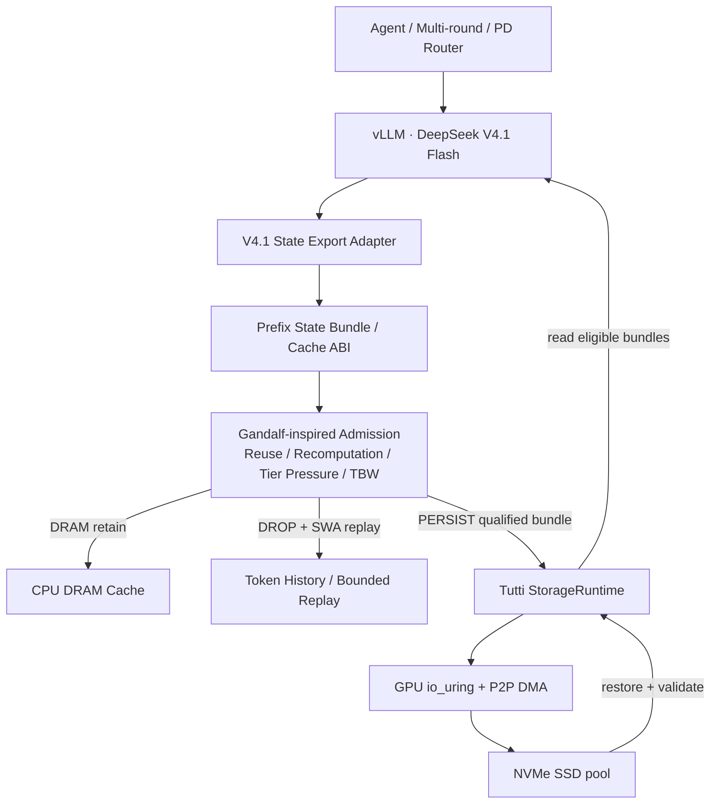
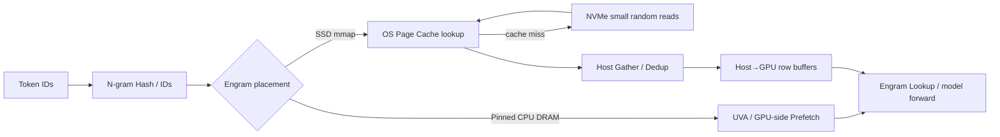

# Tutti × Gandalf × DeepSeek V4.1 Flash：寿命感知 SSD KV Cache 分层架构与 PoC

> 调研日期：2026-10-25  
> 状态：架构设计与适配评估（**不是已运行成功的完整集成**）  
> 目标：面向 Agent / 长上下文 / PD 分离，兼顾前缀恢复 TTFT、SSD Host Write/TBW、缓存有效命中与恢复正确性。  
> 适用优先级：NVIDIA RTX PRO 5000 72GB + vLLM 先验证；Ascend 910C 只能先复用策略思想，不能直接宣称 Tutti 已支持。

## 0. 执行摘要与决策

**结论：建议组合，但应先做 Gandalf 策略移植，后做 Tutti GPU-direct 数据面。**

- **DeepSeek V4.1 Flash** 规定缓存的语义与生命周期：40 层 CED、CSA2（Full / Reindex / Reuse）、FP4 Global KV（约 **890 Bytes/token**）、128-token FP8 SWA、SWA Bounded Replay。上游模型说明：**Global KV 约为 V4 Flash 的 1/4**，**总持久化 KV 约为 V4 Flash 的 1/8**；这两个指标不可混用。[DeepSeek 模型卡][deepseek-hf]、[vLLM 优化文章][vllm-v41]
- **Gandalf** 决定 *哪些缓存值得写到 SSD*：感知 attention type、未来复用概率、DRAM/SSD 压力、写入磨损成本与淘汰损失。论文在 Kimi-K3 与特定 traces/容量下报告平均 **7.3×** 预计 SSD 寿命提升，**不是 V4.1 的实测数据**。[Gandalf][gandalf]
- **Tutti** 决定 *如何快速读写 SSD*：GPU-centric KV object store、GPU io_uring、GPU↔NVMe P2P DMA、批量 I/O。原论文报告相较其测试中的 GDS-enabled SSD LMCache TTFT 降低 78.3%、可承载请求率 2×；该指标也**不等于本组合的预期收益**。[Tutti 论文][tutti-paper]、[Tutti README][tutti]
- **最关键差异**：不能机械照搬 Gandalf「Full Attention 写 SSD，Sparse/Linear 尽量留 DRAM」规则。V4.1 的 **CSA2 Global KV 虽用于稀疏注意力，却是跨层共享、跨轮可复用的持久前缀状态**；真正短期/可重建的是 SWA 窗口。决策单位应是**完整可恢复的 Prefix State Bundle**，而不只是单个 KV tensor。
- **Engram N-gram 的 SSD Offload 是另一条路径**：vLLM 已有实验性 PR，但尚未合并；与 KV SSD 写寿命问题不同，重点是小随机读、Page Cache 命中和 Decode Host 往返。详见第 7 节。
- **落地顺序**：Trace Replay → vLLM/LMCache 上验证 Admission → 验证 V4.1 Global KV/Indexer 状态闭包 → Tutti Connector 扩展 → PD 分离跨节点去重。若 Admission 无明显收益，不应为 Tutti 移植买单。

## 1. 事实、论文结果与工程假设边界

| 项目 | 已有公开证据 | **尚不能推出** |
|---|---|---|
| V4.1 模型结构 | CED 20 编码 + 20 解码层；CSA2 共享 Global KV 和 Indexer K；FP4 Global KV 约 890B/token；FP8 SWA 最近 128 token；Engram 约 196B 静态参数 | 890B/token 自动等于**所有**需要恢复的序列化字节；不同 rank、indexer、alignment、校验开销必须另计/实测 |
| SWA Bounded Replay | vLLM 默认启用，命中前缀重放末尾 128 tokens；并非 bit-exact，官方报告在其评测中质量影响很小 | 所有后端、模型组合均满足同样误差边界；所有 SWA 状态都可无条件丢弃 |
| Gandalf | DRAM→SSD 的 attention-type-aware、capacity-aware Admission + TBW 权重；Kimi-K3 为主的 trace/simulation 实验 | 7.3× 可直接用于 DeepSeek V4.1；可与 1/8 缩减再简单相乘 |
| Tutti | 论文 + 开源 GPU-centric NVMe Runtime、vLLM 外部 Connector；官方给出接口与拓扑约束 | DeepSeek V4.1 已可直接运行；PCIe 5.0/NVMe 理论带宽必然兑现；Ascend 后端已支持 |
| 三者组合 | 分层职责逻辑互补，可设计 Adapter | 尚无本次确认的 V4.1 × Gandalf × Tutti 端到端官方验证 |

**特别说明**：Gandalf 的实验采用 vLLM/LMCache RawBlock、eBPF I/O trace、FEMU 和 trace simulator；模拟寿命计算假设 WAF=1，作者承认不能模型化设备内部 GC/磨损均衡，因此寿命仅为估算。[Gandalf 实现与评估][gandalf-html]

## 2. 按「恢复闭包」拆分 V4.1 缓存，而不是按 Full/Sparse 标签二分

| 对象 | 生成与复用特性 | 初始策略 | 正确性要求 |
|---|---|---|---|
| **Global KV（CSA2, FP4）** | 前缀增长时产生；跨层共享且后续轮次可再次读取 | GPU HBM → DRAM；预期复用收益覆盖成本时 SSD | 保留 FP4 数据、scale、布局、token/rank 映射 |
| **Sparse Indexer K / index 相关状态** | Full / Reindex / Reuse 模式共享 K，并使用候选索引；有持久化与可重算部分 | 按上游实际 Kernel/Connector **定义状态闭包**；可能与 Global KV 共同提交，或按成本安全重建 | 不能只命中 Global KV 就宣称可恢复；需要明确是否包含 index、是否可确定性重算 |
| **SWA KV（FP8, 窗口 128）** | 短期局部窗口；vLLM 通过 Bounded Replay 在 prefix hit 重建 | 默认**不**持久写 SSD，保留必要重放输入 | 保持重放 token 范围、模型兼容，精度非逐 bit 相同 |
| **Engram N-gram 参数表** | 约 196B 静态稀疏查表参数，不是逐请求产生的 KV | **CPU pinned DRAM 优先**；实验性 SSD mmap + OS Page Cache 见第 7 节 | 不计入 KV SSD 耐久 Admission，不能混算读多写少参数表 |
| **Token History / Prefix Manifest** | 可重放语义真相与元数据 | 可靠存储，独立于可丢弃的 KV 副本 | 模型版本、tokenizer、模态输入、并行拓扑、租户/权限、epoch 必须可校验 |

> V4.1 CSA2 的 **Full / Reindex / Reuse 是 indexer/attention 的模式**，并不等于 Gandalf 论文中的 Full 与 Linear/SWA 两类存储生命周期。一部分 indexer 派生数据是否持久化，应由真实实现的恢复依赖图决定。

### 推荐架构



Admission 与 NVMe I/O DataPath 解耦；策略层可以先接普通 SSD 后端验证，Tutti 作为后续可替换的高性能 I/O 后端。**持久对象不等同于可随意恢复**：恢复需校验完整 bundle 与 ABI，不兼容时退化到 Prefill/Replay。

## 3. Gandalf 策略如何改写为 V4.1 版本

论文的直觉：在 DRAM 满时，把丢弃后预计导致的重算成本与写 SSD + 替换已有缓存的成本比较。在线策略示意为：

```text
persist(bundle) only if:
  expected_next_hit_probability * avoided_recompute_value
    > alpha * (SSD_wear_cost + SSD_replacement_loss + restore_overhead)
```

这里是**V4.1 专用的简化设计目标**，不是 Gandalf 论文公式的逐项照搬。正式实现应使用其 capacity-aware 选择过程，并引入以下约束：

1. **SWA Replay 优先**：SWA 不作为独立 SSD Admission 候选；若该引擎/后端不支持 replay，则必须退回完整状态或完整 prefill 的验证路径。
2. **恢复闭包绑定**：Global KV、FP4 scales 与必要 indexer/metadata 在相同 prefix hash、token boundary、epoch、KV ABI 下成为一个原子可恢复 bundle。部分缺失禁止假命中。
3. **增量、幂等、去重写**：已持久的公共前缀采用 block/content identity 复用；只为新块计费和写入。跨 session 去重限于经 ACL 授权的同模型、同 token 序列、同 ABI/量化/布局。
4. **写预算反馈**：用每盘额定 TBW、目标年限、累计 Host Bytes、每日预算与观察到的 NAND WAF（可取到时）更新 wear multiplier；预算超支提高 admission 阈值。
5. **Tier pressure 与反污染**：考虑 DRAM 占用、SSD 候选 victim 的未来命中损失；低价值大对象拒写，防止挤走高价值 Prefix。
6. **SLO 防护**：SSD 恢复时间若超过现场测得 Prefill 时间或 TTFT budget，则不从 SSD 读；异步 Prefetch 与 KV Router 可单独提高收益。

### 概念接口（拟开发，**非** Tutti / Gandalf 正式 API）

```python
@dataclass
class PrefixStateBundle:
    tenant_id: str
    model_revision: str
    tokenizer_hash: str
    prefix_hash: str
    end_token: int
    kv_abi: str
    rank_layout: str
    objects: list        # FP4 global KV + scales + required index state
    restorable: bool     # verified dependency closure
    logical_bytes: int
    generation: int

def decide(bundle, predicted_reuse, recompute_saving,
           wear_cost, replacement_loss, restore_overhead, alpha):
    if not bundle.restorable:
        return "RECOMPUTE_OR_REPLAY"
    benefit = predicted_reuse * recompute_saving
    if benefit > alpha * (wear_cost + replacement_loss + restore_overhead):
        return "PERSIST_VIA_STORAGE_RUNTIME"
    return "KEEP_DRAM_OR_RECOMPUTE"
```

**注意**：持久化需 Manifest 两阶段提交；后台删除需 lease、epoch、tombstone；rank 分片的读写和提交完成必须同步。可对接同仓库 [Client-Owned KV Cache 架构](client-owned-kv-cache-design.md) 的 Snapshot DAG / ACL / Checkpoint 语义。

## 4. SSD 容量、写入量与寿命推导

在「890 Bytes/token 代表待写的 Global KV 基础负载」这一**简化假设**下：

```text
S_prefix(tokens) = tokens × 890 Bytes
W_day(host) = new_unique_prefixes_per_second × S_prefix × 86400
TBW_nominal = SSD_capacity × DWPD × 365 × warranty_years
SSD_life ≈ remaining_TBW / (observed_host_write_rate × observed_WAF)
```

> 真实 NAND 寿命预测应注意厂商 TBW/DWPD 的计量口径；若官方 TBW 明确已是 Host Writes 的额定总量，不应再把模拟 WAF=1 的经验与其直接重复扣算。设备 SMART/厂商磨损指标优先，WAF 作为诊断指标独立跟踪。

| 共同前缀 token | 890B/token 理论全局 KV | 备注 |
|---:|---:|---|
| 8K | 6.8 MiB | 不含额外序列化/分片 |
| 32K | 27.8 MiB | 同上 |
| 64K | 55.6 MiB | 同上 |
| 128K | 111.3 MiB | 同上 |
| 1M（1,048,576） | 890 MiB | 数学上的 1Mi tokens |

对一个 **4 TB、1 DWPD** 的假设 SSD，每日额定 Host Write 预算约 4 TB。假定生成的每个 64K 前缀都**全新且独立写入一次**：

| 每秒新写 64K 前缀 | 每日逻辑写入 | 预算占比 |
|---:|---:|---:|
| 0.1 | 0.504 TB/day | 12.6% |
| 0.5 | 2.520 TB/day | 63.0% |
| 1 | 5.040 TB/day | 126.0% |
| 2 | 10.080 TB/day | 252.0% |

这些是**场景算术**而非 V4.1 的性能/日写入实测，不包含去重、DRAM 截留、逻辑对象复制、meta/indexer 或物理写放大。

**增量写入示例**：已有 64K Prefix，再追加 1K 时，理论新增 Global KV 约 0.87 MiB；如每轮粗暴重写整个 65K Prefix，则约 56.5 MiB。真正收益取决于 Tutti object identity、缓存粒度及 vLLM 连接器的重用能力，**不能假定现有接口已自动全局增量去重**。

### 为什么不能外推 Gandalf 的 7.3×

V4.1 **已通过 SWA Bounded Replay 避免**大量原本需要持久化的短生命周期 SWA 状态，这恰好覆盖了 Gandalf 在许多 hybrid 模型中最大的一块收益来源。余下值得优化的是 Global KV 的准入、索引恢复成本、DRAM 占用、全局去重和预算约束。Gandalf 在 Kimi-K3 等模型、100GB DRAM/1TB SSD 的 7.3× 平均值不能迁移，更不能与 V4.1 约 1/8 的持久化缩减相乘。

## 5. Tutti 接入：接口、可行性与阻塞项

Tutti 公开 `StorageRuntime` 接口包含 `open/open_batch/register/submit/wait` 等操作，底层通过 GPU io_uring、`snvme`、`tutti_daemon` 执行 NVMe I/O；GPU 对 SSD 要求真实 P2P DMA 拓扑。[Tutti 官方入门][tutti-start]

**2026-10-25 官方文档的具体边界**：

- Tutti v0.2.0 已有**外部 vLLM Connector** 与 MiniMax 主 KV / 稀疏 index 逐实体路径；目前官方写明 **DeepSeek 仍需单独适配**。
- 其 Connector 仍列出多 KV Group、部分 K/V 布局、CUDA Graph 的限制；异步完成路径还缺少完整 NVMe/LLM 回归。不能据此宣布 V4.1 的 40 层 CED/CSA2/FP4/Indexer 可以直接落地。
- RTX PRO 5000 节点需确认 GPU↔NVMe PCIe P2P 可达，ACS/IOMMU 配置，NVMe 控制器是否同 PCIe Switch，是否为允许测试的**专用空盘**；先做逐字节正确性和回滚，不应在业务盘运行 destructive hardware test。
- Tutti 的 Linux 5.10 相关代码/移植文档不等于目标主机经过 P2P NVMe 真机验证。Ascend 910C/Linux 5.10 上不能把 NVIDIA Tutti 的 GPU-direct 能力当作现成路径；先做 **Gandalf Policy + 可用的 LMCache/Ascend OffloadingConnector** 基线。

| 层 | 优先落地点 | 后续扩展 |
|---|---|---|
| vLLM Engine / V4.1 | 提取逻辑 Prefix / Global KV + Indexer 状态与恢复校验 | FP4 动态分片、跨拓扑复原 |
| Gandalf Policy | Python sidecar/connector 前置 admission | 反馈闭环、DRAM/SSD victim cost |
| Tutti DataPath | **先验证独立 I/O 与支持的模型**；再写 V4.1 Adapter | GPU io_uring 调优、KV 异步 Prefetch |
| PD Router / Cache Catalog | 单节点先不引入分布式写协议 | 跨 P/D Prefix 去重、对象引用计数、租户 ACL |

## 6. 推荐 PoC：四组对照 + 五层验收

### 实验对照

| 组 | Runtime/策略 | 目标 |
|---|---|---|
| A：基线 | vLLM V4.1，默认 SWA Replay，正常 Prefix Cache | 测得冷 Prefill/热 Prefix 的 TTFT/TPOT |
| B：全写 | 普通 DRAM/SSD 后端，Global KV eligible blocks 全部持久化 | 写入量上界及 SSD hit 收益 |
| C：策略 | B + Gandalf-inspired capacity/wear-aware Admission | **单独归因**寿命/写入改善 |
| D：数据面 | C + Tutti V4.1 Adapter（完成后） | **单独归因**恢复延迟/带宽改善 |

### 验收顺序

1. **Trace Replay**：根据 Claude Code/Harness 多轮 traces 建立 session、token prefix、cache size、idle/next-return 分布；不对真实 SSD 做长期磨损实验。
2. **恢复闭包正确性**：对 Global KV+indexer，验证命中后恢复/重算的 logits 容忍误差，覆盖跨 block、rank、模式、CUDA Graph、量化 scale；记录 SWA Replay 的非 bit-exact 边界。
3. **策略收益**：同 trace、同 DRAM/SSD 容量，对比 B/C 的 Host Write TB/day、有效完整 Prefix Hit Rate、重算 tokens、P99 TTFT；一旦 SLO 恶化则回退。
4. **Tutti 硬件验证**：在专用 NVMe 上验证 P2P、读写逐字节一致性、I/O 排队、控制器/进程故障、数据提交顺序；确认 C/D 的额外收益。
5. **多节点/PD 分离**：同一公共 Prefix 不在 P、D 两侧重复持久写入，完成 manifest、租约、鉴权/删除、故障重试和 200GbE 增量传输预算闭环。

推荐按 8K/32K/64K/128K、并发 8/16/32/64/128/256/512、跨轮追加 1K/4K、多会话共享前缀 0/25/50/75% 的矩阵测试；高并发必须先通过 baseline 才逐级扩大。

### 必报指标

- **延迟与吞吐**：P50/P99 TTFT、TPOT、ITL、SLO Goodput、SSD read latency/throughput。
- **缓存质量**：*可完整恢复* Prefix Hit Rate、重算 token 比、Admission/Drop 比例、Indexer restore failure、冷 miss vs 热 hit。
- **介质与成本**：Host Write GB/day、NAND Write（设备可提供时）、WAF、TBW 预算消耗、预计寿命、DRAM 占用、单个有效命中节省的 SSD 写入字节。
- **隔离可靠性**：跨租户 ACL、epoch/lease、崩溃后原子恢复、删除后无 stale resurrection、模型/ABI 不匹配自动退 Prefill。

**Go/No-go 判据**：先要求 C 在接近 B 的完整 Prefix Hit Rate / TTFT SLO 下显著减少 Host Writes，再投入 V4.1 Tutti Connector 的工程成本。D 的读性能必须优于 C 且不增加异常恢复/数据损坏风险。

## 7. Engram N-gram SSD Offload：Prefill / Decode 性能和本方案的边界（2026-10-25 增补）

### 7.1 首先区分两种「SSD 卸载」

DeepSeek V4.1 的 **Engram N-gram 是基本静态、读多写少的参数表**；KV Cache 是请求产生的动态状态。两者不应共享相同的默认持久化策略：

| 维度 | Engram N-gram 参数表 | Global KV + Indexer |
|---|---|---|
| 生命周期 | 模型权重版本绑定，静态、多次查表 | 请求动态生成，可被后续 Prefix 复用 |
| 典型访问 | 细粒度、随机行读取；哈希确定访问位置 | KV Block / State Bundle 批量读写 |
| SSD 主要代价 | 冷读随机 I/O、CPU 参与 Gather、Step 同步 | 写放大与 TBW、恢复延迟、索引一致性 |
| 推荐默认落点 | **CPU pinned DRAM + UVA / Prefetch** | HBM→DRAM→SSD，有选择地持久化 |
| 内存不足时 | mmap safetensors + OS Page Cache（实验性） | 通过 Gandalf-inspired Admission 降低持久写入 |
| Gandalf 写寿命策略 | **不宜直接套用**（不是逐请求持续写的 KV） | 主要适用对象 |
| Tutti 当前复用 | **没有即插即用的 Engram 后端** | 存在 KV Connector，V4.1 仍要适配 |

Engram 表规模上游 PR 的口径约 **197 GB（十进制）/189 GiB（二进制）**，不要把整个表视为每张 GPU 各复制一份；TP/Engram DP 会按分片放置，跨节点、DP 副本及加载方式决定每台主机的实际占用。

### 7.2 vLLM 主线和 SSD Offload PR 状态

| 能力/实现 | 截至 2026-10-25 | 使用条件、已知限制 |
|---|---|---|
| vLLM Engram `cpu_offload` | 现成基线 | CPU pinned DRAM + UVA / Prefetch；需满足平台 UVA、CPU DRAM 容量 |
| [PR #62238][engram-pr62238] `disk_offload` | **Open，未合并**；2026-10-18 提交，2026-10-23 仍有合并冲突提醒 | mmap checkpoint safetensors，本机 Page Cache 按行 Gather；仅 DeepSeek V4.1；需 Eager 或 Breakable Piecewise CUDA Graph |
| [PR #56757][engram-pr56757] `disk_offload_dir` | **Closed，未合并** | 另一实现：建立本地 SSD 分片，host Gather 与 decoder layer 重叠；拥有较完整 B200 性能报告 |
| Tutti vLLM Connector | 已有部分 KV 能力 | **不是** Engram table SSD reader；缺少成熟的 N-gram 专用查询/预取接口 |

示例（**仅 PR #62238 分支**的实验命令，主线不能照此使用）：

```bash
vllm serve deepseek-ai/DeepSeek-V4.1-Flash \
  --engram-config '{"disk_offload": true}' \
  --enforce-eager
# PR 描述另提供：
# VLLM_USE_BREAKABLE_CUDAGRAPH=1 -cc.cudagraph_mode=PIECEWISE
```

该 PR 每步先把 Hash ID 交给 Host，按去重后的行号从 mmap / Page Cache 取数据，拷入固定 GPU Buffer，再运行 Engram Lookup Kernel。**Page Cache 命中只免去了 SSD 物理读，并不消除 CPU Gather、主机往返、Host↔GPU 同步、Graph Break 的固定成本。** mmap 不是将全部页常驻 pinned DRAM；内存紧张时缓存页会被回收，下一轮可能触发真实 SSD 4KiB 随机读取。

### 7.3 Prefill 与 Decode：为什么影响不同



- **Prefill**：批量 token 较多，可以去重、批量行读取，并与层计算重叠；因此吞吐更容易摊销 Host/IO 开销。但首次冷读、多并发抢占 Page Cache、随机缺页会推高 TTFT/P99 TTFT。
- **Decode**：每一步输出 token 较少，且依赖本步 N-gram 哈希和 Gather 完成才可继续；小批量时固定 Host round trip 对 TPOT/ITL 更敏感。即使全部 Page Cache 命中也可能变慢。
- **高并发反转**：当 pinned Engram 占据的 DRAM 挤压 KV Tier / 其他请求容量时，SSD mmap 允许冷页回收，额外内存可提升总体 Goodput。因此不能简单判断「SSD 一定让所有工作负载更慢」。

### 7.4 上游实测数字（必须注明 PR、硬件及对照口径）

**实验 A：[PR #56757][engram-pr56757]，B200 TP4，8K 输入 / 1K 输出**

作者报告：在**固定并发 16**、三轮对照中，CPU pinned + UVA 的吞吐为 **13,632 ± 806 tok/s**，Disk backend 为 **14,168 ± 104 tok/s**；Host memory in use 从 **352 GB 降至 95 GB**。这说明系统瓶颈受可用 DRAM / 缓存竞争影响，不能把 SSD 方案等价为简单延迟损失。

同 PR 的 Agentic traces 结果如下，**SSD 对照的是作者此前发布的同 recipe baseline，不是严格同机同步的逐项 A/B**：

| 并发 | SSD 吞吐 / 报告基线 | 基线 P90 TTFT | SSD P90 TTFT | 解读 |
|---:|---:|---:|---:|---|
| 1 | 63% | 958 ms | 1,205 ms | 低并发明显退化 |
| 2 | 58% | 558 ms | 695 ms | 低并发固定 Host 开销占比大 |
| 8 | 78% | 477 ms | 497 ms | 吞吐仍下降 |
| 16 | 90% | 551 ms | 598 ms | 接近但未追平 |
| 32 | 92% | 784 ms | 685 ms | 一些尾延迟已改善 |
| 64 | 95% | 1,325 ms | 1,092 ms | 吞吐接近 |
| 96 | 135% | 18,217 ms | 4,992 ms | 内存压力下反超 |
| 128 | 147% | 290,749 ms | 193,493 ms | 两臂均已进入严重过载，不能以此保证 SLO |

PR 同时报告本实现的 Decode **median TPOT 存在约 2.6ms/token 的近似固定额外开销**，主要源自 Host 往返，而非 SSD 设备延迟；其随机 4KiB 读取实测约 70µs，稳定状态下多数页命中 Page Cache。这个 2.6ms 是**特定 PR/硬件/路径的观测**，不是所有硬件的预测值。

对比 **Host Gather 与 decoder layer 重叠**（同 PR 的 SSD 方案内部消融）：

| 指标 | Inline Gather | Overlapped Gather |
|---|---:|---:|
| 吞吐 | 14,163 tok/s | 14,330 tok/s |
| Mean TTFT | 984.79 ms | 696.70 ms |
| P99 TTFT | 6,508.53 ms | 4,145.65 ms |
| Median TPOT | 8.71 ms | 8.42 ms |

这组数字说明对 Prefill/TTFT，重叠和调度可能比单纯 SSD 顺序吞吐重要；但该 PR 已关闭未合并，不能当作现有主线性能承诺。

**实验 B：[PR #62238][engram-pr62238]，4× AMD Strix Halo（gfx1151，128 GB/台），TP4 over Ray，Eager**

- 每 rank mmap 两份约 **23.6 GiB** Engram rows；原主线 CPU pinned 表导致其目标节点无法完成模型加载。
- 提交者报告：Decode **11.0 tok/s（tg128）**，Prefill **208 tok/s（pp2048）**，KV Cache **1.74M tokens**。
- **缺少相同拓扑的 CPU Offload A/B 对照**，所以这些绝对吞吐不能用于推断 SSD 相对性能下降百分比。
- CUDA Graph 仅单测覆盖；作者报告该 RCCL/TCP 集群首请求 collective hang，且无 disk path 时的 V4 Flash stock kernels 同样存在这一现象。因此也不能宣称 PR 通过了生产集群 Graph 回归。

### 7.5 对 RTX PRO 5000 72GB × 8 / 512GB DRAM / 4TB NVMe 的具体决策

**默认建议：Engram CPU DRAM，Global KV 由 SSD + Gandalf/Tutti（待适配）管理。**

1. **容量先核算**：若同节点 TP 分片共同持有一份 Engram 表，其合计约 189 GiB（实际还受 EDP/DP 布局、加载临时副本与 pinned 内存影响）；512GB DRAM 并不自动需要 Engram SSD Offload。先测 `MemAvailable`、pinned/locked、GPU 显存、KV Pool 预留、同机 NUMA 分布。
2. **Decode 节点**：优先 pinned DRAM + UVA + Prefetch，以压低每步固定 Host 访问开销；不建议在低并发、低 TPOT SLO 下默认切 SSD。
3. **Prefill 节点**：CPU DRAM 通常仍最稳；当长上下文及多请求的 DRAM/KV 抢占严重时，可实验 mmap Engram，用释放的可回收页换取更高批处理能力。
4. **SSD 不是统一缓存池**：Engram 静态权重页读取和 KV Cache 的动态块写入应该分别观察延迟、Page Cache 命中与 TBW；Engram 常规推理主要是读负载，**不能把 Gandalf KV 写寿命收益迁移为 Engram 寿命收益**。
5. **Tutti 优先服务 KV**：Engram 用 mmap/Host Gather 的小粒度随机访存，Tutti 是 GPU-centric KV Object I/O Runtime。若要通过 Tutti 优化 Engram，需要新建 hash→row→batched P2P read→GPU buffer 的数据路径、IO 并行与图执行契约，不是替换一个文件后端即可。

**优先实验矩阵**：同模型 commit、同 TP/DP/EDP 拓扑，同 SSD，做 Engram `pinned DRAM` vs `SSD mmap`（实验 PR 构建）；再正交组合 KV tier（HBM-only / DRAM / SSD）。分别测 Prefill-only（1K/8K/64K）、Decode-only（输出 128/1K）、混合 Agent traces，并覆盖并发 1/2/8/16/32/64。冷热 Page Cache 单独报告，避免把预热状态的表现当作冷读延迟。监测 TTFT P50/P99、TPOT/ITL P50/P99、Goodput、Engram 行缓存 hit、SSD 4KiB Read IOPS、CPU Gather/Host-sync 时间、CUDA Graph 使用情况、DRAM pinned / Page Cache / KV Pool、Host Write TBW。

### 7.6 对 Tutti + Gandalf 研究路线的增量价值

把 **Storage Policy 分成两条**：

- **动态、读写型 KV/Indexer**：Gandalf 根据复用/重算/TBW 预算决定 SSD Admission；Tutti 在硬件验证后提高 KV I/O 性能。
- **静态、随机读型 Engram**：优先 CPU DRAM，内存紧张时才尝试 mmap/Page Cache + 行去重/流水预取；单独优化 Decode Host round trip、异步 Hash Prefetch 和可捕获的 Graph execution。

若未来两个数据流确实共用 SSD，还需要 **I/O QoS 隔离**，避免 Engram 小随机读和 KV 批量写在同一个 NVMe 队列中相互影响，特别是 Decode P99 ITL。只有验证队列隔离收益后，才值得研究将 Tutti 扩展为统一的多类状态 I/O runtime。

## 8. 与既有项目的关系

- [Client-Owned KV Cache][client-kv]：解决 **谁有权 Checkpoint/Restore/Prefetch/Delete**；本方案解决 **一个恢复闭包值不值得写 SSD，以及怎样高效 I/O**。未来可将 Gandalf Policy 作为其 Gateway 的 Storage Policy，将 Tutti 作为本地 SSD 数据面，但二者当前均非该设计的现成可用实现。
- [910C / Linux 5.10 KV Cache Pool 评估][ascend-pool] 与 [DRAM 地址不重叠后的四路线替代][ascend-alternatives]：昇腾环境先落实内核、HCCS 地址窗口与实际 KV 传输后端；Admission Policy 可以独立于 Tutti 迁移。

## 9. 资料与实现参考

1. [DeepSeek-V4.1-Flash 模型卡 / 官方结构与缓存比例][deepseek-hf]
2. [DeepSeek-V4.1-Flash 技术报告 arXiv:2609.19969][deepseek-paper]
3. [vLLM: DeepSeek V4.1 Flash 优化与 SWA Bounded Replay][vllm-v41]
4. [Gandalf: Flash Shall Not Die! arXiv:2610.30791][gandalf] · [论文全文 HTML][gandalf-html]
5. [Tutti GitHub][tutti] · [论文 arXiv:2605.03375][tutti-paper] · [官方部署与 Connector 限制][tutti-start]
6. [vLLM Engram SSD Offload 实验 PR #62238][engram-pr62238] · [B200 对照及低并发瓶颈 PR #56757（已关闭）][engram-pr56757]

[deepseek-hf]: https://huggingface.co/deepseek-ai/DeepSeek-V4.1-Flash
[deepseek-paper]: https://arxiv.org/abs/2609.19969
[vllm-v41]: https://vllm-project.github.io/2026/10/07/deepseek-v41-flash.html
[gandalf]: https://arxiv.org/abs/2610.30791
[gandalf-html]: https://arxiv.org/html/2610.30791v1
[tutti]: https://github.com/xPU-IO/Tutti
[tutti-paper]: https://arxiv.org/abs/2605.03375
[tutti-start]: https://github.com/xPU-IO/Tutti/blob/main/doc/getting-started.md
[engram-pr62238]: https://github.com/vllm-project/vllm/pull/62238
[engram-pr56757]: https://github.com/vllm-project/vllm/pull/56757
[client-kv]: client-owned-kv-cache-design.md
[ascend-pool]: ascend-910c-kernel510-kv-cache-pool-feasibility.md
[ascend-alternatives]: ascend-kernel510-hccs-dram-address-mismatch-kv-offload-comparison.md
